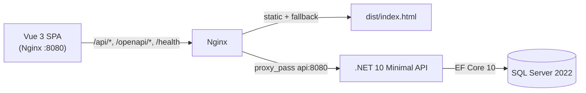
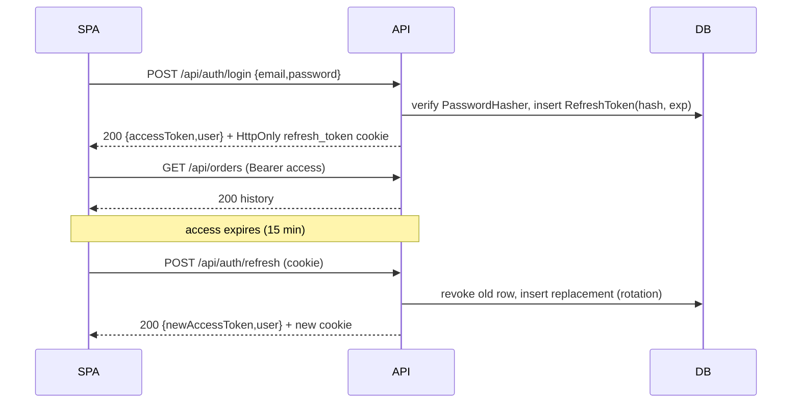
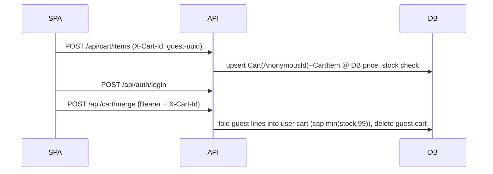

# Architecture

## System overview

Three Compose services (`portecommerce` project): `db` (SQL Server, named volume
`portecommerce_mssql_data`, no published ports), `api` (published only inside the
Compose network), `nginx` (only entrypoint, `${HOST_PORT:-8080}` → 80).

## Backend projects

- `Ecommerce.Core` — entities, DTOs, `PricingRules`, service interfaces, `DomainException`.
- `Ecommerce.Infrastructure` — `AppDbContext` (explicit FKs, unique slugs, decimal(18,2),
  filtered unique indexes for nullable cart keys), SQL-Server migration, `SeedData`,
  `DesignTimeFactory` (keeps `dotnet ef` from booting the API).
- `Ecommerce.Api` — Minimal API endpoint groups (`MapGroup`), services
  (`Auth/Catalog/Cart/Order/Account/Admin`), FluentValidation validators,
  JWT bearer auth + `Admin` policy, fixed-window `auth` rate limiting, CORS for the
  Vite dev origin, `/health` + `/health/db`, built-in OpenAPI at `/openapi/v1.json`
  (+ dev-only `/swagger` UI page).
- `Ecommerce.Tests` — xUnit unit + `WebApplicationFactory` integration tests on
  isolated per-class SQLite in-memory databases.

All endpoints use DTOs, async EF Core, DI services, and `ProblemDetails` errors.
`DomainException(message, statusCode)` maps business failures (400/401/403/404/409)
without leaking internals.

## Auth flow (JWT + rotating refresh tokens)

Reuse of a rotated/revoked token → 401. Access tokens live only in frontend memory;
the refresh cookie is `HttpOnly`, `SameSite=Lax`, `Secure` when HTTPS, `Path=/api/auth`.

## Cart flow (guest → login merge)

Prices are never trusted from the client; totals recompute from DB prices with
legacy shipping tiers + 8 % tax.

## Checkout transaction

`POST /api/orders` (auth): validate addresses/method → idempotency check →
`BEGIN TRANSACTION` → reload cart + authoritative prices/stock → compute
subtotal/shipping/tax/total → insert `Order` + `OrderItem`s with product/address
snapshots → decrement stock → clear cart → `COMMIT`. Retried `IdempotencyKey`
returns the original order (201). Oversell is prevented by server-side stock checks
inside the transaction; concurrent over-commit beyond available stock is rejected.

## Frontend

Vue 3 + TS strict + Vite + Vue Router (history mode) + Pinia + Axios + Bootstrap 5
+ `src/assets/store.css` brand system (fluid `stx-shell` max 1720px, CSS-grid
product grid, card/detail/table states).
`useProductBrowse` composable drives the catalog in two modes: server-side
**pagination** (page envelope, numbered nav) and **infinite scroll**
(IntersectionObserver sentinel, id-deduped appends, request-id race guard,
end-of-results + retry); mode persists in `localStorage`, filters/sort/page stay
in the URL query. `apiClient` attaches the in-memory token and `X-Cart-Id` (localStorage `cart_id`),
retries once via `/auth/refresh` on 401, else clears auth and routes to `/login`.
Product art is deterministic local SVG (`/images/products/<slug>.svg`, baked into
the Nginx image); cards/detail render the saved `ImageUrl` verbatim with a
loop-guarded placeholder fallback.
Critical startup ordering: `auth.init()` (silent refresh) completes **before**
`app.use(router)` + `mount`, so the initial navigation's guards see the restored
session (full-page loads of protected routes would otherwise bounce to login —
found and fixed during E2E verification).

## Configuration & secrets

No secrets in git (`.env` ignored; `.env.example` documents all vars).
`DB_PASSWORD` + `JWT_KEY` are required Compose vars (fail-fast `${VAR:?...}`).
`appsettings.json` keeps `${PLACEHOLDER}` tokens; the API resolves
config → environment → safe dev fallback in one helper (`CfgOrEnv`) after a real
production incident where signing and validation keys diverged (see TESTING).
